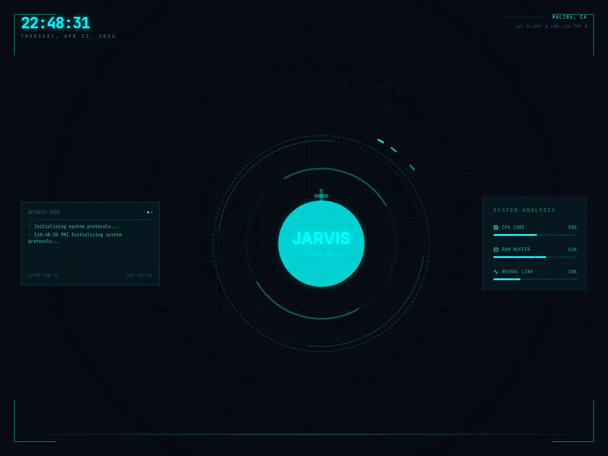
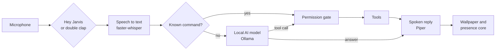
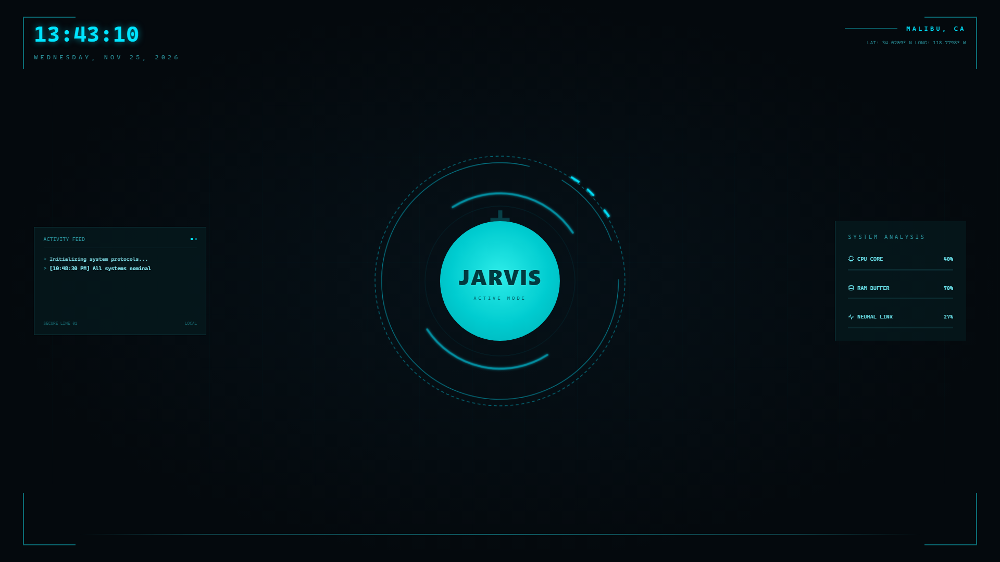
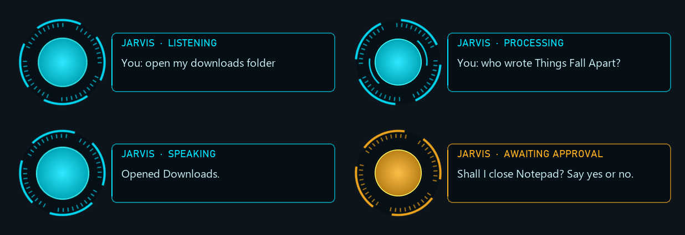

# Jarvis

**A private voice assistant for Windows with a live desktop wallpaper.**



Wake Jarvis by saying **"Hey Jarvis"** or **clapping twice**, then tell him what to do. He opens apps and folders, controls windows and media, manages files, sets reminders, answers questions and reports on your accounts. Speech recognition, the voice and the AI model all run on your own computer.


## Table of contents

- [Features](#features)
- [How it works](#how-it-works)
- [Requirements](#requirements)
- [Installation](#installation)
- [Usage](#usage)
- [The wallpaper and presence core](#the-wallpaper-and-presence-core)
- [Configuration](#configuration)
- [Safety and permissions](#safety-and-permissions)
- [Privacy](#privacy)
- [Connecting your accounts](#connecting-your-accounts)
- [Performance](#performance)
- [Known limitations](#known-limitations)
- [Troubleshooting](#troubleshooting)
- [Project structure](#project-structure)
- [Development](#development)
- [Credits and licences](#credits-and-licences)

## Features

- **Two ways to wake:** "Hey Jarvis" or a double clap. A second check with Whisper helps with accents the wake model doesn't know.
- **Natural conversation:** Jarvis stays awake for 60 seconds after each answer, so you don't have to wake him again.
- **Instant commands:** common requests skip the AI model entirely.
- **Local AI:** everything else goes to a model running in [Ollama](https://ollama.com/), which can use Jarvis's tools.
- **Live wallpaper:** shows the time, your location, what Jarvis is doing, and CPU and memory use.
- **Presence core:** a small animated core appears in the corner when apps cover the wallpaper.
- **Permission gate:** risky actions need your approval, enforced in code rather than left to the AI.
- **Account reports:** read-only summaries for Gmail, YouTube, Instagram and Facebook Pages. Jarvis never posts.
- **Starts with Windows:** optional, with a spoken greeting.

## How it works



| Part | Technology |
|---|---|
| Wake word | openWakeWord (`hey_jarvis`), checked by Whisper when unsure |
| Clap detection | Custom NumPy detector |
| Speech to text | faster-whisper `base`, int8 on CPU |
| Voice | Piper (`en_GB-alan-medium`) |
| AI model | Ollama with `qwen3.5:4b` |
| Wallpaper | HTML, CSS and JavaScript in Lively Wallpaper |
| Storage | SQLite for logs and reminders, Windows Credential Manager for tokens |

## Requirements

| | |
|---|---|
| Operating system | Windows 11 |
| Python | 3.14 from [python.org](https://www.python.org/downloads/) |
| Memory | 16 GB recommended. About 4 GB must be free to load the AI model. |
| Disk space | About 5 GB |
| Graphics card | Not needed |
| Other | A microphone, speakers, and [Lively Wallpaper](https://www.rocksdanister.com/lively/) |

Setup installs [uv](https://docs.astral.sh/uv/) and Ollama if they are missing.

## Installation

1. **Get the code**

   ```powershell
   git clone https://github.com/YOUR-USERNAME/YOUR-REPOSITORY.git
   cd YOUR-REPOSITORY
   ```

2. **Run setup.** It creates `config.toml`, installs the dependencies, and downloads the speech models, the city list and the AI model (3.3 GB).

   ```powershell
   powershell -ExecutionPolicy Bypass -File scripts\setup.ps1
   ```

3. **Add the wallpaper.** Open Lively Wallpaper, drag `dist\Jarvis-HUD.zip` onto its window, and choose **Jarvis HUD**.

   > **Keep this zip private.** It contains a token that lets the page read Jarvis's status.

4. **Start Jarvis**

   ```powershell
   .\.venv\Scripts\python.exe -m jarvis
   ```

5. **Optional: start with Windows**

   ```powershell
   powershell -ExecutionPolicy Bypass -File scripts\install_autostart.ps1
   ```

   Add `-Remove` to undo this.

## Usage

Wake Jarvis, wait for his greeting, then speak. The tray icon lets you pause listening, open the log or quit.

### Instant commands

| Say | What happens |
|---|---|
| "Open Notepad", "open YouTube" | Opens an app or a well-known website, maximized and in front |
| "Open my downloads folder", "open D drive" | Opens a folder in File Explorer |
| "Open Notepad and maximize it" | Runs several commands in order |
| "Maximize it", "switch to Chrome" | Controls windows |
| "Close Notepad" | Closes an app, after you approve |
| "Set the volume to 30", "mute" | Controls the volume |
| "Pause", "next song" | Controls media playback |
| "Search for flights to Nairobi" | Opens a web search |
| "What time is it?", "check system status" | Tells the time, or CPU, memory, battery and disk |
| "Remind me to call mum in 10 minutes" | Sets a spoken reminder |
| "Give me my report", "check my email" | Reads your account report |
| "That's all", "go to sleep" | Ends the conversation |

### AI requests

Anything else goes to the local AI model:

- "Make a note on my desktop called shopping with milk and eggs"
- "Move report.pdf from Downloads to Documents"
- "Who wrote Things Fall Apart?"

### Typed commands

To try a request without a microphone:

```powershell
.\.venv\Scripts\python.exe -m jarvis --text "open notepad"
```

## The wallpaper and presence core



The live wallpaper reacts as Jarvis listens, thinks and speaks. It shows OFFLINE when Jarvis isn't running and reconnects by itself. To preview it in a browser, open `wallpaper\index.html?demo=1`.

When apps or folders cover the wallpaper, the presence core appears in the bottom-left corner. Clicks pass straight through it. It hides on the bare desktop, and over full-screen apps while Jarvis is idle.



## Configuration

Settings are in `config.toml`, which setup creates from [`config.example.toml`](config.example.toml). Restart Jarvis after editing.

| Setting | Section | Default | Purpose |
|---|---|---|---|
| `greetings` | `[assistant]` | three phrases | What Jarvis says when he wakes |
| `startup_greeting` | `[assistant]` | time-based | Greeting when Windows starts him; `""` for silence |
| `auto` | `[location]` | `true` | Use Windows Location, or the fixed place below it |
| `wake_threshold` | `[wake]` | `0.5` | Lower wakes more easily |
| `clap_sensitivity` | `[wake]` | `0.6` | Higher wakes more easily |
| `active_seconds` | `[listen]` | `60` | How long he stays awake after an answer |
| `model` | `[brain]` | `qwen3.5:4b` | Ollama model |
| `keep_alive` | `[brain]` | `"30m"` | How long the model stays in memory when unused |
| `allowed` | `[files]` | Documents, Desktop, Downloads | Folders Jarvis may use for files |
| `open_window` | `[apps]` | `"maximize"` | Use `"normal"` to keep each app's usual size |
| `enabled` | `[presence]` | `true` | Show the presence core |

## Safety and permissions

Every action passes through one permission gate. Unknown tools are refused.

| Level | Examples | What happens |
|---|---|---|
| **Free** | Open apps, search, change volume, read files in allowed folders | Runs |
| **Ask** | Close apps, type text, create or move files | Say "yes" or click Yes |
| **Click only** | Delete to the Recycle Bin, run PowerShell | Click Yes on screen; your voice can't approve it |
| **Never** | Known dangerous commands, such as formatting drives or changing Defender settings | Refused |

- No answer within 30 seconds counts as **no**.
- File tools only work inside the folders listed in `config.toml`. PowerShell commands are not limited to those folders, so read them before clicking Yes.
- Every action is logged in `data\jarvis.db`.
- Text from files and emails is treated as information, never as instructions. After reading any, opening links, web searches and apps needs approval until your next request.

The refused list is a safety net based on known patterns. It can't recognise every harmful command.

## Privacy

- Speech, voice and AI processing happen on your computer.
- Microphone audio stays in memory and is never saved. What you say is kept as text in `data\jarvis.log`.
- Your location comes from Windows and is matched to a city offline by Jarvis.
- Jarvis uses the internet for setup downloads, websites and searches you ask for, and accounts you connect.
- Account tokens are kept in Windows Credential Manager.
- `config.toml`, `data\` and the wallpaper token are excluded from Git.

## Connecting your accounts

Account access is optional and read-only. To see what's connected:

```powershell
.\.venv\Scripts\python.exe -m jarvis.reports.setup status
```

<details>
<summary><strong>Gmail and YouTube</strong></summary>

1. In [Google Cloud Console](https://console.cloud.google.com/), create a project.
2. Enable the **Gmail API** and the **YouTube Data API v3**.
3. Set up the OAuth consent screen as **External** and add yourself as a test user.
4. Create an OAuth client ID of type **Desktop app**, and save its JSON file as `data\google_client_secret.json`.
5. Run `.\.venv\Scripts\python.exe -m jarvis.reports.setup google` and approve access in the browser.
6. Set `gmail = true` and `youtube = true` in `config.toml`.

While the app is in **Testing**, Google ends the sign-in after about 7 days. Switching it to **In production** avoids that.

</details>

<details>
<summary><strong>Instagram</strong> (Business or Creator account)</summary>

1. At [developers.facebook.com](https://developers.facebook.com/), create an app with the Instagram use case.
2. Open **Instagram → API setup with Instagram business login**, add your account and generate a token.
3. Run `.\.venv\Scripts\python.exe -m jarvis.reports.setup instagram` and paste the token.
4. Set `meta = true` in `config.toml`.

Tokens last 60 days. Jarvis refreshes them when you ask for a report.

</details>

<details>
<summary><strong>Facebook Page</strong></summary>

Run `.\.venv\Scripts\python.exe -m jarvis.reports.setup facebook`, enter your Page ID and a Page access token, then set `meta = true` in `config.toml`.

</details>

**X, TikTok and LinkedIn** aren't read directly, because their APIs cost money or need approval. Jarvis counts their notification emails in Gmail instead.

## Performance

Measured on a laptop with a 4-core Intel i5-8365U, 16 GB of memory and no dedicated graphics card:

| Measure | Result |
|---|---|
| Benchmark accuracy | 18 of 20 commands |
| Benchmark speed, first model step | 13.0 s median, 22.1 s slowest |
| Full AI answer, excluding speech | 14–34 s |
| Loading the AI model after a wake | 100–110 s |
| Understanding a short spoken command | 1.2 s |

Instant commands don't wait for the AI model. Results are from single benchmark runs and vary with what else is running. To test your own computer:

```powershell
.\.venv\Scripts\python.exe scripts\bench.py qwen3.5:4b
```

## Known limitations

- **Windows and English only.**
- **Slow first AI request:** the model takes time to load after a long break.
- **Memory:** with many browser tabs open, there may not be enough free memory for the AI model.
- **Nearby voices:** while awake, Jarvis may treat a video or another person as you.
- **One at a time:** he can't hear you while he is thinking or speaking.
- **Small-model mistakes:** AI answers can be wrong, so check anything important.
- **Account reports** are tested with sample data. Compare the first report with each website.
- **Smaller fallback model:** `qwen3.5:2b` is supported, but it isn't installed by setup and hasn't been benchmarked.

## Troubleshooting

| Problem | What to do |
|---|---|
| "There isn't enough free memory to think" | Close some browser tabs, then ask again |
| He doesn't wake, or wakes by mistake | Adjust `wake_threshold` or `clap_sensitivity` |
| The AI model download keeps stopping | Run `ollama pull qwen3.5:4b` again |
| The wallpaper shows OFFLINE | Check that Jarvis is running, then rebuild the zip with `scripts\make_wallpaper.py` and add it again |
| The location is missing | Turn on location access in Windows settings, then run `scripts\download_models.py` |
| "Port 8765 is in use" | Jarvis is probably already running |
| A file is blocked by Smart App Control | Use Python from python.org, not another build |

The log is in `data\jarvis.log`. It can contain what you said, so check it before sharing.

## Project structure

```text
jarvis/
  audio/      microphone, wake word, clap, speech to text, voice
  brain/      instant-command router and AI tool loop
  reports/    Gmail, YouTube, Instagram and Facebook
  safety/     permission levels, approval dialogs, action log
  tools/      everything Jarvis can do, and the permission gate
  ui/         wallpaper feed, presence core, tray icon
scripts/      setup, model downloads, benchmark, autostart
tests/        automated tests
wallpaper/    the live wallpaper page
docs/images/  images used in this README
```

## Development

```powershell
.\.venv\Scripts\python.exe -m pytest
```

Please run the tests before opening a pull request. New tools belong in `jarvis/tools/catalog.py`, each with a permission level.

## Credits and licences

Jarvis builds on [openWakeWord](https://github.com/dscripka/openWakeWord), [faster-whisper](https://github.com/SYSTRAN/faster-whisper), [Piper](https://github.com/OHF-Voice/piper1-gpl), [Ollama](https://ollama.com/), [Qwen](https://github.com/QwenLM) and [Lively Wallpaper](https://github.com/rocksdanister/lively). City data is from [GeoNames](https://www.geonames.org/) (CC BY 4.0).

Each of these has its own licence. In particular, Piper is GPL-3.0-or-later, and the openWakeWord pretrained models are licensed for non-commercial use.

This is an independent personal project. It is not affiliated with or endorsed by any company or film franchise.
